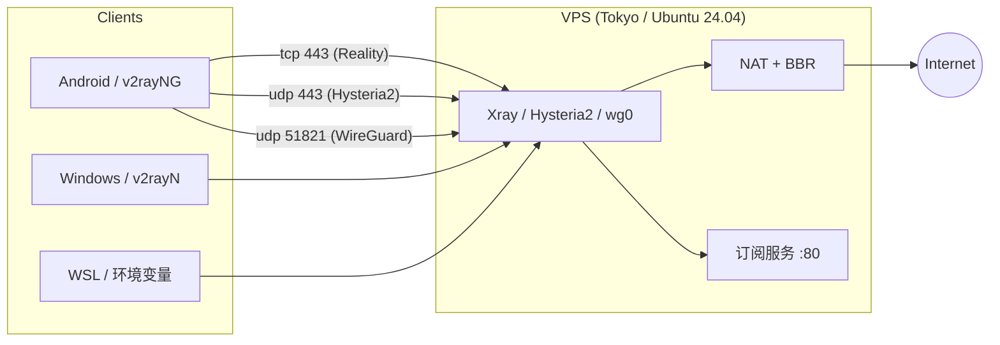

# vultr-vpn

[](https://github.com/zjr284/vultr-vpn/actions/workflows/ci.yml)
[](https://github.com/zjr284/vultr-vpn/releases)
[](LICENSE)

> 一条命令，在自己的 VPS 上搭好三通道代理：**WireGuard + Xray Reality + Hysteria2**，外加一个订阅地址。

写这套东西的起因很简单：市面上的"一键脚本"要么只给一种协议，要么把密钥写死在脚本里、换个 IP 就得重配所有客户端。这里的目标是——**换服务器时，客户端只需要改一个地址**。

> 🚀 **第一次接触服务器？** 先看 [**零基础教程**](docs/beginner.md)：不用买域名、不用懂 Linux，全程复制粘贴，30 分钟从注册 Vultr 到手机能上网。
>
> 🤖 **想让 AI 帮你部署？** 把 [docs/agent-deploy.md](docs/agent-deploy.md) 丢给 Claude Code / Codex / Cursor / DSH 这类会执行命令的 agent，它会自己连服务器、装好、体检、验证订阅，最后只把订阅地址交给你。人只需要提供 SSH 和一句“帮我部署”。

---

## 特性

- **三通道并存**，一条被墙还有两条
  - `WireGuard` — udp 51821，速度最快、最省电
  - `Xray VLESS + Reality` — tcp 443，伪装成正常 HTTPS，抗封锁最强
  - `Hysteria2` — udp 443，QUIC，抗丢包抗抖动
- **密钥持久化**：首次运行生成 `config.env`，重装系统后客户端配置基本不用动
- **自动证书**：Let's Encrypt + 自动续期 hook，不再需要 `allowInsecure`
- **订阅服务**：一个 URL 导入所有节点，换密钥点一下"更新订阅"
- **幂等**：脚本可以重复跑，已存在的配置不会被覆盖
- **国内分流**：服务端 `geoip:cn` / `geosite:cn` 直连

## 架构



## 快速开始（一行）

在全新装好的 Ubuntu 22.04 / 24.04 上，以 root 执行：

```bash
bash <(curl -fsSL https://raw.githubusercontent.com/zjr284/vultr-vpn/main/install.sh) --domain vpn.example.com
```

这一行里包含：下载仓库 → 装依赖 → 内核调优 → 三通道配置 → 签证书 → 起订阅服务 → 打印节点链接和订阅二维码。

### 连防火墙也不用碰控制台

有 Vultr API Key 的话（控制台 → Account → API），把端口放行也交给脚本：

```bash
bash <(curl -fsSL https://raw.githubusercontent.com/zjr284/vultr-vpn/main/install.sh) \
     --vultr-key "$VULTR_API_KEY" --vultr-fw vpn --domain vpn.example.com
```

它会自动：按公网 IP 找到本机实例 → 没挂防火墙组就建一个并挂上 → 放行 `tcp 22/80/443`、`udp 443/51821`。

> **API Key 有 IP 白名单**，必须包含这台机器出口的公网 IP，否则返回 `401 Unauthorized IP address`。
> 国内访问 `raw.githubusercontent.com` 不稳的话，用镜像前缀：
> `bash <(curl -fsSL https://ghproxy.net/https://raw.githubusercontent.com/zjr284/vultr-vpn/main/install.sh)`，
> 或者 `git clone` 下来直接 `bash setup.sh`（本地有 `setup.sh` 时 `install.sh` 会用本地副本）。

### 常用命令

| 命令 | 作用 |
|---|---|
| `bash setup.sh --check` | 体检：服务、端口、证书剩余天数、订阅、防火墙 |
| `bash setup.sh --links` | 只打印节点链接（不碰任何配置） |
| `bash setup.sh --domain vpn.example.com` | 换域名：重签证书 + 换 Hysteria2 SNI + 刷新订阅 |
| `bash setup.sh --cert-only` | 证书没签下来时补签 |
| `bash setup.sh --reset` | 重新生成全部密钥（客户端要重新导入） |

### 版本与发布

每个版本打 `vX.Y.Z` tag，[Releases](../../releases) 里附带打包好的 `vultr-vpn-vX.Y.Z.tar.gz` 和 `SHA256SUMS`。

生产环境建议**锁定版本**，避免 `main` 上的改动影响正在跑的机器：

```bash
bash <(curl -fsSL https://raw.githubusercontent.com/zjr284/vultr-vpn/v1.1.0/install.sh) \
     --ref v1.1.0 --domain vpn.example.com
```

不写 `--ref` 时跟随 `main`（最新）。CI 会在每次推送时跑 `bash -n`、`shellcheck -S error`、Python 语法检查，以及一段"真实 IP/密钥泄漏"扫描。

跑完会打印类似：

```
===============================================================
 部署完成
   服务器   : 203.0.113.10   (vpn.example.com)
   WireGuard: udp 51821
   Reality  : tcp 443
   Hysteria2: udp 443
   订阅地址 : http://vpn.example.com/dsh-sub-xxxxxxxx.txt
   客户端   : /opt/vultr-vpn/clients/{windows,wsl,phone}.conf
===============================================================

【订阅二维码】（客户端扫这个，不要扫单节点）
  █▀▀▀▀▀▀▀▀▀▀▀▀▀▀▀█
  ...
```

浏览器打开订阅域名根路径，还有一个网页版清单（订阅地址 + 两个节点 + 一键复制）。

## 脚本做了什么

| 步骤 | 内容 |
|---|---|
| 1 | 装 wireguard-tools / xray / hysteria / certbot / qrencode |
| 2 | 内核调优：BBR + fq + 32MB 缓冲区 + `ip_forward` |
| 3 | 写 `wg0.conf`（服务端 + 三个 peer），开 IP 转发和 MASQUERADE |
| 4 | 写 Xray Reality 配置（uTLS 指纹 chrome，SNI 用真实站点） |
| 5 | 云防火墙自动放行（给了 API Key 时）→ certbot 签证书 → 装续期 hook |
| 6 | 写 Hysteria2 配置（含 QUIC 窗口调优） |
| 7 | 起订阅服务（systemd `dsh-sub`），80 明文 + 8443 HTTPS |
| 8 | 配 ufw，生成三份客户端配置，打印链接与二维码 |

几个容易翻车的地方脚本已经替你处理：

- **sshd 占着 443** 的机器：自动把它改回 22，否则 Xray 起不来
- **证书续期**时 80 被订阅服务占用：renewal 配置里加了 `pre_hook/post_hook` 临时停启
- **不覆盖旧配置**：`config.env` 存在就复用密钥，重跑只做增量
- **防火墙规则有延迟**：签发失败时会提示等 2 分钟再 `--cert-only`

## 目录结构

```
.
├── install.sh            # 一行入口（下载仓库并调用 setup.sh）
├── setup.sh              # 主脚本
├── config.example.env    # 配置模板（真实配置是 config.env，已 gitignore）
├── scripts/sub.py        # 订阅服务（含网页版清单）
├── .github/workflows/    # CI（语法/shellcheck/密钥扫描）+ 打 tag 自动发 Release
├── docs/
│   ├── beginner.md       # 零基础教程（不买域名、复制粘贴即可）
│   ├── 01-server.md      # 选机器、开防火墙
│   ├── 02-deploy.md      # 部署细节与报错
│   ├── 03-clients.md     # 手机 / Windows / WSL
│   ├── 04-troubleshoot.md# 连不上怎么查
│   └── 05-rebuild.md     # 被封后 15 分钟重建
└── clients/              # 运行时生成，已 gitignore
```

## 实测数据

东京 `vc2-1c-1gb`（$5/月），北京联通 5G，2026-11：

| 通道 | 下载 | Ping | 抖动 |
|---|---|---|---|
| Reality | 127 Mbps | 151 ms | 88 ms |
| Hysteria2 | 148 Mbps | 107 ms | 151 ms |
| 直连（对照） | 102 Mbps | 187 ms | 112 ms |

> 带宽不是瓶颈，**国际链路延迟和抖动**才是。想真正快，得换 CN2 GIA 之类的优化线路。

## 常见坑（都写进文档了）

1. **手机连上但没流量** → 大概率是 IP 被整段墙，不是配置问题
2. **云防火墙规则有 1~3 分钟延迟** → 改完立刻测会误判
3. **新版 Xray 内核移除了 `allowInsecure`** → 必须用正式证书
4. **sslip.io 域名随 IP 变** → 长期用请配自己的域名
5. **订阅和节点同机** → IP 被封时订阅也打不开，留好本地备份

## 免责声明

本项目仅供学习网络协议与 Linux 运维使用。请遵守你所在地区的法律法规以及云服务商的条款，不要用于任何违法用途。

## License

MIT
