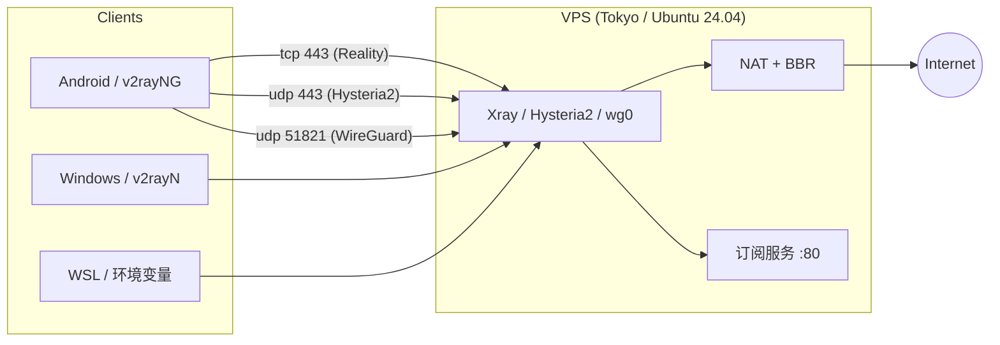

# vultr-vpn

> 一条命令，在自己的 VPS 上搭好三通道代理：**WireGuard + Xray Reality + Hysteria2**，外加一个订阅地址。

写这套东西的起因很简单：市面上的"一键脚本"要么只给一种协议，要么把密钥写死在脚本里、换个 IP 就得重配所有客户端。这里的目标是——**换服务器时，客户端只需要改一个地址**。

---

## 特性

- **三通道并存**，一条被墙还有两条
  - `WireGuard` — udp 51821，速度最快、最省电
  - `Xray VLESS + Reality` — tcp 443，伪装成正常 HTTPS，抗封锁最强
  - `Hysteria2` — udp 443，QUIC，抗丢包抗抖动
- **密钥持久化**：首次运行生成 `config.env`，重装系统后客户端配置基本不用动
- **自动证书**：Let's Encrypt + 自动续期 hook，不再需要 `allowInsecure`
- **订阅服务**：一个 URL 导入所有节点，换密钥点一下"更新订阅"
- **幂等**：脚本可以重复跑，已存在的配置不会被覆盖
- **国内分流**：服务端 `geoip:cn` / `geosite:cn` 直连

## 架构



## 快速开始

```bash
# 1. 上传到服务器
scp setup.sh root@<YOUR_SERVER_IP>:/root/

# 2. 一条命令部署
ssh root@<YOUR_SERVER_IP> "bash /root/setup.sh"

# 或者用自己的域名（推荐）
ssh root@<YOUR_SERVER_IP> "bash /root/setup.sh --domain vpn.example.com"
```

跑完会打印：

```
===============================================================
 部署完成
   服务器   : 203.0.113.10   (vpn.example.com)
   WireGuard: udp 51821
   Reality  : tcp 443
   Hysteria2: udp 443
   订阅地址 : http://vpn.example.com/dsh-sub-xxxxxxxx.txt
   客户端   : /root/clients/{windows,wsl,phone}.conf
===============================================================
```

把订阅地址贴进客户端，完事。

## 脚本做了什么

| 步骤 | 内容 |
|---|---|
| 1 | 装 wireguard-tools / xray / hysteria / certbot |
| 2 | 内核调优：BBR + fq + 32MB 缓冲区 |
| 3 | 写 `wg0.conf`（服务端 + 三个 peer），开 IP 转发和 MASQUERADE |
| 4 | 写 Xray Reality 配置（uTLS 指纹 chrome，SNI 用真实站点） |
| 5 | certbot 申请证书 → 部署给 Hysteria2 → 装续期 hook |
| 6 | 写 Hysteria2 配置（含 QUIC 窗口调优） |
| 7 | 起订阅服务（systemd `dsh-sub`） |
| 8 | 配 ufw，生成三份客户端配置 |

## 目录结构

```
.
├── setup.sh              # 主脚本
├── config.example.env    # 配置模板（真实配置是 config.env，已 gitignore）
├── scripts/sub.py        # 订阅服务
├── docs/
│   ├── 01-server.md      # 选机器、开防火墙
│   ├── 02-deploy.md      # 部署细节与报错
│   ├── 03-clients.md     # 手机 / Windows / WSL
│   ├── 04-troubleshoot.md# 连不上怎么查
│   └── 05-rebuild.md     # 被封后 15 分钟重建
└── clients/              # 运行时生成，已 gitignore
```

## 实测数据

东京 `vc2-1c-1gb`（$5/月），北京联通 5G，2026-11：

| 通道 | 下载 | Ping | 抖动 |
|---|---|---|---|
| Reality | 127 Mbps | 151 ms | 88 ms |
| Hysteria2 | 148 Mbps | 107 ms | 151 ms |
| 直连（对照） | 102 Mbps | 187 ms | 112 ms |

> 带宽不是瓶颈，**国际链路延迟和抖动**才是。想真正快，得换 CN2 GIA 之类的优化线路。

## 常见坑（都写进文档了）

1. **手机连上但没流量** → 大概率是 IP 被整段墙，不是配置问题
2. **云防火墙规则有 1~3 分钟延迟** → 改完立刻测会误判
3. **新版 Xray 内核移除了 `allowInsecure`** → 必须用正式证书
4. **sslip.io 域名随 IP 变** → 长期用请配自己的域名
5. **订阅和节点同机** → IP 被封时订阅也打不开，留好本地备份

## 免责声明

本项目仅供学习网络协议与 Linux 运维使用。请遵守你所在地区的法律法规以及云服务商的条款，不要用于任何违法用途。

## License

MIT
