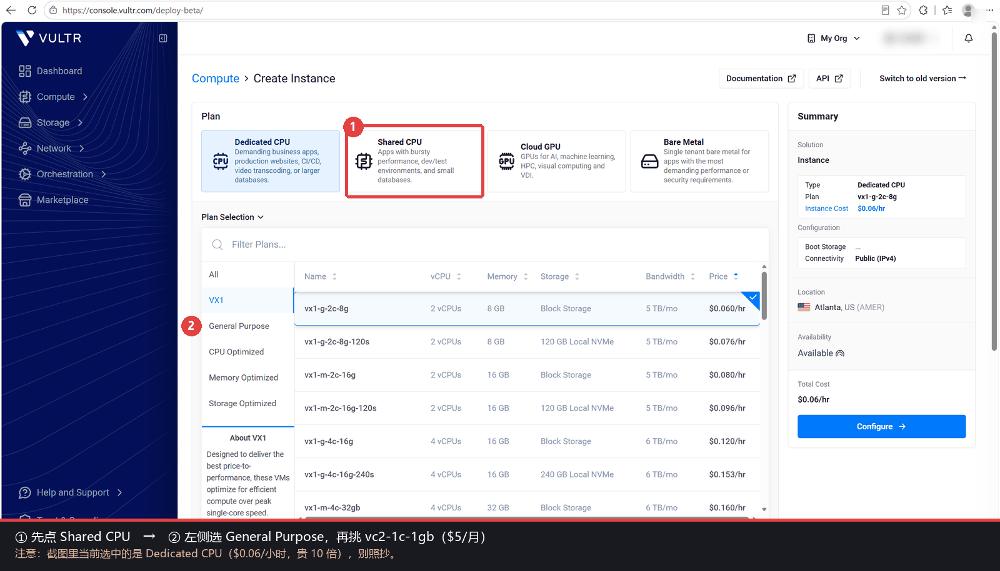
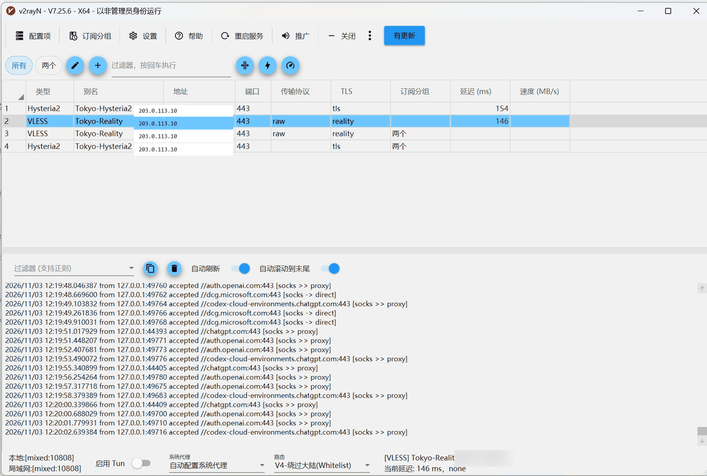

# 零基础教程：30 分钟搭好自己的 VPN（不需要买域名）

> 这份教程假设你**从来没碰过 Linux、没连过服务器**。
> 跟着做，全程只需要复制粘贴，不需要域名、不需要备案、不需要懂代码。
>
> 完成后你会得到：一个只有你自己在用的代理，手机和电脑都能连，速度取决于你选的机房。
>
> 📝 这份教程（以及配套的部署脚本）是在 **DeepSeek Harness** 里边排查边写出来的：从"手机连上但没流量"一路查到目标 IP 被整段黑洞，再换机器、补脚本、整理成文。文中所有命令都在真实服务器上跑过。

**目录**

1. [开始前先看](#1-开始前先看)
2. [注册 Vultr 并充值](#2-注册-vultr-并充值)
3. [创建服务器](#3-创建服务器)
4. [连上服务器](#4-连上服务器)
5. [一行命令安装](#5-一行命令安装)
6. [手机导入](#6-手机导入)
7. [电脑导入](#7-电脑导入)
8. [验证成功 & 打开分流](#8-验证成功--打开分流)
9. [日常维护](#9-日常维护)
10. [常见问题](#10-常见问题)
11. [费用与流量](#11-费用与流量)
12. [安全与合规](#12-安全与合规)
13. [进阶：换成自己的域名](#13-进阶换成自己的域名推荐)

---

## 1. 开始前先看

### 你需要准备

| 东西 | 说明 |
|---|---|
| 一台电脑 | Windows / macOS 都行，用来连服务器 |
| 一部手机 | Android 或 iPhone |
| 一个 Vultr 账号 | 国外云服务商，支持支付宝 |
| 约 40 元人民币 | 最低充值 $10，按小时计费，不用了随时删 |
| 30–40 分钟 | 第一次做会慢一点，熟练后 10 分钟 |

### 你会得到什么

```
你的手机 ──加密隧道──> 你的服务器（东京）──> 互联网
```

- 节点只有你自己用，不共享，比买的机场更安全
- 一条线路被封，还有另外两条（本教程自动装三条）
- 每月 $5（约 ¥36），1TB 流量，正常用不完

### 合法提醒

自建代理本身是合法的技术实践，但**请遵守你所在地的法律法规和云服务商条款**。
不要用它做任何违法的事，也不要分享给别人（共享是 IP 被封的头号原因）。

---

## 2. 注册 Vultr 并充值

**网址**：https://www.vultr.com

### 步骤

1. 右上角 **Sign Up**，用邮箱 + 密码注册（也可以用 Google 账号）
2. 注册后会让你绑支付方式，选 **Alipay（支付宝）** 或信用卡
3. 充值：右上角头像 → **Billing** → **Add Funds** → 最低 **$10**

### 可能遇到的问题

| 问题 | 解决 |
|---|---|
| 注册后提示账号被标记（fraud） | 给 support@vultr.com 发邮件，说明你是正常用户，一般 1 天内解封 |
| 支付宝付款后余额没到 | 等 10 分钟，或刷新页面；没到就联系客服 |
| 想先试用 | Vultr 偶尔有 $100/14 天体验金，绑卡后自动到账，注意它是**赠金不能提现** |

> 💡 **不用买域名**：脚本会用 `sslip.io` 的公共泛解析。
> 比如你的服务器 IP 是 `203.0.113.10`，域名就是 `203-0-113-10.sslip.io`，
> 它会自动解析回这个 IP，完全够用，也支持申请证书。
>
> （以后想换成自己的域名更稳，见文末 [第 13 节](#13-进阶换成自己的域名推荐)，5 分钟。）

---

## 3. 创建服务器

登录后点右上角蓝色的 **Deploy +** → **Deploy New Server**。



> 上图是新版控制台。**注意别停在 Dedicated CPU** —— 那是给企业跑数据库用的，价格是 Shared CPU 的十倍。
> 先点 ①，再在左侧选 ②。

按下面这张表选，其它全部保持默认：

| 选项 | 选什么 | 为什么 |
|---|---|---|
| Type | **Cloud Compute – Shared CPU** | 最便宜，够用 |
| CPU & Storage | **Regular Performance** | 最便宜档 |
| Location | **Tokyo**（东京） | 离国内近，延迟低；试了不满意可以删了重建 |
| Image | **Ubuntu 24.04 LTS x64** | 脚本适配这个系统 |
| Plan | **vc2-1c-1gb**（$5/月） | 1 核 1G，够跑三条通道 |
| Auto Backups | **关掉** | 会额外收费 20% |
| IPv6 | 开（默认就开着） | 多一条路 |
| SSH Keys | **留空，先跳过** | 选了密钥就只能用密钥登录，新手容易卡住；留空才会给你 root 密码 |
| Hostname | `tokyo` 或随便 | 只是名字 |
| Server Quantity | `1` | |

> 🔥 **Firewall Group 保持 None**。Vultr 新账号默认没有防火墙组，等于全端口开放，脚本一会儿会自动签发证书。
> 如果你之前建过防火墙组并在这里选中了它，必须放行：`tcp 22、80、443` 和 `udp 443、51821`，否则第 5 步一定卡在证书上。

拉到最下面点 **Deploy Now**。

### 等它装好

大约 **1–2 分钟**，状态从 `Installing` 变成 **`Running`**。

点进去，你会看到：

```
IP Address : 203.0.113.10      ← 记下这个
Username   : root
Password   : xxxxxxxx          ← 点右边的眼睛图标显示
```

📌 **把 IP 和密码复制到记事本**，下一步要用。

> ⚠️ 密码只在创建时显示一次。忘了也没关系：实例页面可以 **View Password** 重置。

---

## 4. 连上服务器

"连服务器"就是用一条命令，让你的电脑黑框框里操作那台远端的机器。

### Windows

1. 按 `Win` 键，输入 **PowerShell**，回车（不用管理员）
2. 输入下面这行（把 IP 换成你的）

> 📋 **怎么粘贴**：复制命令后，在 PowerShell 窗口里**点右键**就会自动粘贴（或者按 `Ctrl+V`）。
> 只复制命令本身，别把前面灰色的 `PS C:\>` 一起复制进来。

```powershell
ssh root@203.0.113.10
```

3. 第一次会问：

```
Are you sure you want to continue connecting (yes/no/[fingerprint])?
```

输入 `yes` 回车。

4. 然后输入密码（**输入时屏幕上不显示任何字符，这是正常的**），回车。

成功的话你会看到类似：

```
Welcome to Ubuntu 24.04 LTS ...
root@tokyo:~#
```

最后那个 `#` 就是"你在服务器上了"。

### macOS

打开 **终端**（Launchpad 里搜 Terminal），命令完全一样：

```bash
ssh root@203.0.113.10
```

### 常见报错

| 报错 | 原因 & 解决 |
|---|---|
| `Connection timed out` | IP 错了 / 服务器还没 Running / 你的网络拦了 22 端口。换手机热点试试 |
| `Permission denied (publickey)` | 创建服务器时选了 SSH Key，就不再允许密码登录。最省事是**删掉重建、SSH Keys 留空**；或者在你电脑上用密钥登录 `ssh -i 密钥文件 root@IP` |
| `REMOTE HOST IDENTIFICATION HAS CHANGED` | 你重建过机器，IP 还是旧的指纹。执行 `ssh-keygen -R 203.0.113.10` 再连 |
| `ssh: command not found`（Windows 老版本） | Win10 1809 以下没有自带 ssh。装 Git for Windows 或用 PuTTY |

---

## 5. 一行命令安装

**这一步是全部的部署工作**。在服务器的 `#` 提示符后面，粘贴这一整行（回车）：

```bash
bash <(curl -fsSL https://raw.githubusercontent.com/zjr284/vultr-vpn/main/install.sh)
```

> 🌐 **如果这条命令卡住不动或报 `Failed to connect`**：是 GitHub 在国内偶尔连不上，直接换成下面这条镜像（内容和上面完全一样），不用等：
>
> ```bash
> bash <(curl -fsSL https://ghproxy.net/https://raw.githubusercontent.com/zjr284/vultr-vpn/main/install.sh)
> ```

然后等 **3–6 分钟**，屏幕上会滚动很多 `[+ ]` 开头的日志，别关窗口。

### 如果卡住或报错

**问题 1：`curl: (7) Failed to connect`**

国内服务器访问 GitHub 有时会抽风。换成镜像地址：

```bash
bash <(curl -fsSL https://ghproxy.net/https://raw.githubusercontent.com/zjr284/vultr-vpn/main/install.sh)
```

**问题 2：一直停在 `安装依赖`**

再等 2 分钟，Ubuntu 第一次 `apt update` 本来就慢。真的卡死就 `Ctrl+C` 中断，然后重跑同一个命令（脚本是幂等的，重复跑不会坏）。

**问题 3：证书签发失败**

会看到：

```
[! ] 签发失败，日志: /tmp/certbot.log
[! ] 常见原因: 云厂商防火墙未放行 tcp 80
```

云防火墙规则生效有 1–3 分钟延迟。等两分钟，执行：

```bash
bash /opt/vultr-vpn/setup.sh --cert-only
```

### 成功的样子

```
===============================================================
 部署完成
   服务器   : 203.0.113.10   (203-0-113-10.sslip.io)
   WireGuard: udp 51821
   Reality  : tcp 443
   Hysteria2: udp 443
   订阅地址 : http://203-0-113-10.sslip.io/dsh-sub-1a2b3c4d.txt
   客户端   : /opt/vultr-vpn/clients/{windows,wsl,phone}.conf
===============================================================

【节点链接】
vless://xxxxxxxx-xxxx-...@203-0-113-10.sslip.io:443?...
hysteria2://xxxxxxxx@203-0-113-10.sslip.io:443/?...

【订阅二维码】（客户端扫这个，不要扫单节点）
  █▀▀▀▀▀▀▀▀▀▀▀▀▀▀▀█
  ...
```

📌 **把"订阅地址"那一行复制到记事本**，这是最关键的东西：

```
http://203-0-113-10.sslip.io/dsh-sub-1a2b3c4d.txt
```

> 这个地址浏览器也能打开，里面是两行编码后的节点。**别发到群里**。
> 它是 http 明文的（80 端口，没加密）——图的是"不用证书也能访问"，代价是谁拿到这个地址谁就能用你的节点。

---

## 6. 手机导入

### Android：v2rayNG

1. 下载安装 **v2rayNG**
   - GitHub：https://github.com/2dust/v2rayNG/releases
   - 找 `v2rayNG_x.x.x_arm64-v8a.apk`（现在的手机基本都是 arm64），或名字带 `universal` 的那个
   - 手机浏览器打不开 GitHub 时，在链接前面加镜像前缀再打开：
     `https://ghproxy.net/https://github.com/2dust/v2rayNG/releases`
   - 装的时候手机会提示"未知来源"，允许即可
2. 打开 v2rayNG → 左上角 **☰** → **订阅分组设置**
3. 右上角 **+** → **添加订阅**
4. 填两栏：
   - **备注**：随便，比如 `东京`
   - **地址 (URL)**：粘贴你的订阅地址
5. 返回，点右上角 **⋮** → **更新订阅**
6. 会多出两个节点：`Tokyo-Reality` 和 `Tokyo-Hysteria2`
7. **先选 `Tokyo-Reality`**（更稳）→ 点右下角灰色圆形按钮变成**绿色 V**
8. 打开浏览器访问 **https://api.ip.sb/ip**，显示你的服务器 IP 就成功了

> 🔁 **更新订阅失败，或底部提示"请不要使用不安全的 HTTP 协议订阅地址"？**
> - 脚本最后会打印**两条**订阅地址：`https://你的域名:8443/dsh-sub-xxx.txt`（推荐）和 `http://你的域名/dsh-sub-xxx.txt`（备用）。
>   **优先填 https 那条**，客户端就不会拦你（前提：云防火墙放了 tcp 8443，见第 3 节）。
> - 如果只能用 http：在订阅设置最下面把「允许不安全的 HTTP 地址」开关打开。
> - 更新订阅前先断开连接（点一下圆形按钮变回灰色），否则走代理去更新自己会死循环。

> **选哪个节点？**
> - 看视频、日常用 → **Reality**（延迟低、抖动小）
> - 玩游戏、丢包严重 → **Hysteria2**（抗丢包）
> - **WireGuard** 在手机上有单独 App，速度最快但特征最明显，被封风险最高，不推荐日常用

### iPhone

iOS 没有免费的同类客户端，需要**非国区 Apple ID**：

1. 注册/借用一个美区 Apple ID，App Store 登录
2. 下载 **Shadowrocket**（$2.99）或 **sing-box**（免费）
3. 添加订阅的方式类似：Shadowrocket 首页右上角 **+** → 类型选 **Subscribe** → 粘贴地址
4. 连接后在设置里开全局路由

> 国区 App Store 已经下架了这类 App，装不上是正常的，不是脚本的问题。

---

## 7. 电脑导入

### Windows：v2rayN

1. 下载：https://github.com/2dust/v2rayN/releases
   - 选 `v2rayN-windows-64.zip`；打不开 GitHub 就在网址前加 `https://ghproxy.net/`
   - 双击提示缺少 .NET 的话，改下名字里带 `SelfContained` 的包
2. 解压到任意目录，双击 `v2rayN.exe`

> ⚙️ **第一次打开会弹窗问"是否下载 Xray 内核"，点确定。**
> 这一步要从 GitHub 拉文件，国内可能很慢或失败；失败了就重新打开软件再试一次，或者挂上手机热点。
3. 顶部菜单 **订阅** → **订阅设置** → **添加**
   - 备注：`东京`
   - 地址：粘贴订阅地址
4. **订阅** → **更新订阅（不通过代理）**
5. 左侧列表出现两个节点，**双击 `Tokyo-Reality`**
6. 右下角托盘图标右键 → **系统代理** → **自动配置系统代理**
7. 浏览器访问 https://api.ip.sb/ip 验证



> 上图看三个地方：
> ① 地址栏应该只有**你自己那一台**服务器的 IP/域名（Reality 用 IP、Hysteria2 用域名，两种都正常）；
> ② **延迟 100–200 ms** 说明节点通着（显示 `-1` 就是连不上）；
> ③ 底部日志里 `[socks >> proxy]` 是走代理、`[socks -> direct]` 是直连——这就是「绕过大陆」在工作。
> 如果**全是** `>> proxy`，说明分流没开，回去看下一节。

### macOS

推荐图形客户端，配置方式和 Windows 一样：**订阅地址 → 导入 → 选节点**。

| 客户端 | 说明 |
|---|---|
| **Clash Verge Rev** | 界面新、支持订阅和自动分流，装完在「订阅」里粘贴地址即可 |
| **V2rayU** | 老牌客户端，更新慢但能用 |

> ⚠️ 别在 Mac 上手动跑 `hysteria client -c ~/hysteria.yaml`：那份配置在**服务器**上，本机没有这个文件。
> 真想用命令行，得先把服务器上的 `hysteria.yaml` 用 `scp` 拉到本地，再改里面的地址——不值得，用图形客户端省事。

---

## 8. 验证成功 & 打开分流

### 怎么算成功

浏览器打开 https://api.ip.sb/ip，返回的是**你的服务器 IP**（比如 `203.0.113.10`）就通了。

如果还是你家宽带的 IP，说明代理没生效：

- 客户端没点"连接"
- 浏览器开了别的代理插件（关掉 SwitchyOmega 之类）
- 系统代理没开（Windows 要在 v2rayN 里点"自动配置系统代理"）

### ⚠️ 一定要打开"绕过大陆"

不开的话，你访问**国内网站也绕一圈日本**，又慢又费流量。

| 客户端 | 设置路径 |
|---|---|
| v2rayNG | 左上角 ☰ → **设置** → **路由设置** → 勾选 **绕过大陆地址** |
| v2rayN | 主界面 → **路由** → 选择 **绕过大陆** |
| Shadowrocket | 设置 → **分流** → 选 **配置**（默认规则即可） |

这样：国内网站直连（快），国外网站走代理。

### 测速参考

东京机房 + 北京联通 5G 的实测（同一台服务器）：

| 通道 | 下载 | Ping | 抖动 |
|---|---|---|---|
| Reality | 127 Mbps | 151 ms | 88 ms |
| Hysteria2 | 148 Mbps | 107 ms | 151 ms |
| 直连对照 | 102 Mbps | 187 ms | 112 ms |

> 带宽不是瓶颈。**延迟 150ms 左右是物理距离决定的**（北京→东京约 2100km），
> 想更快只能换 CN2 GIA 之类的高价线路，或者接受现实。

---

## 9. 日常维护

### 日常检查（一条命令）

```bash
bash /opt/vultr-vpn/setup.sh --check
```

输出像这样，全绿就没事：

```
检查项                      结果     说明
服务 wg-quick@wg0          OK
服务 xray                  OK
服务 hysteria-server       OK
服务 dsh-sub               OK
WireGuard udp/51821        OK
TCP 443 (Reality)          OK
证书 203-0-113-10.sslip.io OK       剩 89 天
订阅（本机 80）             OK
```

### 什么时候该怀疑"被封了"

按顺序判断：

| 现象 | 结论 |
|---|---|
| 三个节点全连不上，但手机能上网 | 可能 IP 被封 |
| 能 ping 通服务器，但 80/443 都连不上 | 大概率被封 |
| 服务器自己 `curl https://google.com` 正常 | 服务器没问题，是链路被封 |
| 只是某个节点连不上 | 那个协议被针对，换另一个 |

**决定性测试**：手机用流量（关 Wi-Fi）访问 `http://你的IP/`。
能打开 → 没被封，是客户端配置问题。
打不开 → IP 被墙，走下面的重建流程。

### 被封之后：15 分钟重建

**关键：先把 `/opt/vultr-vpn/config.env` 备份下来**（用 `scp` 或者直接复制内容），
里面有你的密钥，重建时复用，客户端就不用重新导入。

1. Vultr 控制台 → 旧实例 → **Destroy**（不然继续计费）
2. 按 [第 3 步](#3-创建服务器) 重新开一台（**换个机房更快见效**，比如 Osaka / Seoul）
3. 把 `config.env` 传到新机器（先建目录，否则 scp 会报 No such file）：

   ```bash
   ssh root@新IP "mkdir -p /opt/vultr-vpn"
   scp config.env root@新IP:/opt/vultr-vpn/config.env
   ```

4. 跑安装（会自动复用这份密钥）：

   ```bash
   bash <(curl -fsSL https://raw.githubusercontent.com/zjr284/vultr-vpn/main/install.sh)
   ```

5. 客户端点一下「更新订阅」。**如果用 sslip.io 域名，订阅地址里的 IP 段变了，要改一次地址**（脚本会把域名自动改成新 IP 对应的那个）；用自己的域名就什么都不用改

详细版见 [docs/05-rebuild.md](05-rebuild.md)。

### 需要备份的东西

| 文件 | 作用 |
|---|---|
| `/opt/vultr-vpn/config.env` | 所有密钥。丢了就要重新导入客户端 |
| `/opt/vultr-vpn/clients/*.conf` | 三份 WireGuard 客户端配置 |

一条命令打包下载（在你自己的电脑上执行）：

```bash
scp -r root@203.0.113.10:/opt/vultr-vpn/config.env .
```

### 证书会自动续期

Let's Encrypt 证书 90 天，`certbot.timer` 会在到期前 30 天自动续。
如果哪天 Hysteria2 连不上而 Reality 正常，多半是证书没续上：

```bash
bash /opt/vultr-vpn/setup.sh --cert-only
```

---

## 10. 常见问题

| 问题 | 原因 | 解决 |
|---|---|---|
| 手机显示已连接，但打不开网页 | 早期版本常见：IP 被整段墙 | 换机房重建（见上） |
| 订阅地址打不开 | 80 端口被占 / 服务挂了 | `systemctl status dsh-sub`，`systemctl restart dsh-sub` |
| 提示"不安全的 HTTP 订阅" | 客户端拒收明文订阅 | 用 `https://域名:8443/...`；或打开「允许不安全的 HTTP 地址」 |
| 证书签不下来 | 云防火墙没放行 80，或有延迟 | 等 2 分钟 → `--cert-only` |
| `Address already in use` | 443 被别的程序占了（常见是 sshd） | 脚本会自动处理；手动查 `ss -lntp \| grep 443` |
| 连上了但速度只有几 Mbps | 国际链路拥塞 / 本地网络 | `--check` 看服务；换个机房试；避开晚高峰 |
| 重启服务器后全挂了 | 服务没设自启（一般不会） | `systemctl enable --now wg-quick@wg0 xray hysteria-server dsh-sub` |
| 忘了订阅地址 | — | 服务器上执行 `cat /var/www/dsh-sub/*.txt \| base64 -d`，或打开 `http://你的域名/` |
| 想换域名 | — | `bash /opt/vultr-vpn/setup.sh --domain 新域名` |
| 想重新生成密钥 | 密钥泄漏 | `bash /opt/vultr-vpn/setup.sh --reset`（客户端要重新导入） |

---

## 11. 费用与流量

| 项目 | 费用 |
|---|---|
| vc2-1c-1gb（1 核 1G） | **$5/月**，约 ¥36 |
| 流量 | 1TB/月（含），超出 $0.01/GB |
| 快照（可选） | $0.05/GB/月，不用可以不开 |
| 备份（可选） | 实例价格的 20% |

按小时计费：$5/月 ≈ **$0.007/小时**。开了又不用，一个月也就几块钱。
**不用了记得 Destroy，否则一直扣。**

正常使用（看视频、刷网页）一个月大概 50–200GB，1TB 通常用不完。

---

## 12. 安全与合规

**要做：**

- ✅ 订阅地址、`config.env` 当成密码对待，不要发到公开的地方
- ✅ 定期 `--check`，发现异常及时重建
- ✅ 服务器 root 密码改成强密码：`passwd`
- ✅ 只自己用，不要分享给朋友（共享 IP 是被封的最主要原因）

**不要做：**

- ❌ 用这台服务器做任何违法的事
- ❌ 在上面跑爬虫、发垃圾邮件、扫端口（Vultr 会直接封号）
- ❌ 把节点挂到公开的"免费节点"网站

**关于隐私**：你的流量在服务器上是明文出口的（这是所有代理的共性）。
访问敏感网站时，自己心里要有数。

---

## 13. 进阶：换成自己的域名（推荐）

用 sslip.io 有个硬伤：**域名是从 IP 编出来的**。服务器一换 IP，域名立刻失效，订阅地址也得跟着改。
自己买个域名（¥30–80/年）就能一劳永逸：以后换服务器只改一条 DNS 记录，客户端不用动。

### 三步搞定

**1. 买域名**

阿里云 / 腾讯云 / Cloudflare 都行，`.com` 首年 ¥60 左右。买完必须做**实名认证**（国内强制）。
认证通过前，域名会被注册局挂起（状态 `clientHold`），此时**解析怎么配都不生效**——这一步最容易卡住人。

**2. 加一条 A 记录**

在域名控制台的「DNS 解析」里加：

| 主机记录 | 记录类型 | 记录值 |
|---|---|---|
| `vpn` | `A` | 你的服务器 IP |

意思是让 `vpn.你的域名.com` 指向这台服务器。保存后一般 5–10 分钟生效。

**3. 在服务器上切过来**

```bash
bash /opt/vultr-vpn/setup.sh --domain vpn.你的域名.com
```

脚本会重新签证书、把 Hysteria2 的 SNI 换成新域名、刷新订阅内容。跑完把新订阅地址重新导入客户端即可。

### 怎么确认真的生效了

在**你自己的电脑**上执行（不是服务器上）：

```bash
nslookup vpn.你的域名.com
```

返回你的服务器 IP 就对了。如果返回 `NXDOMAIN` 或者找不到，去查域名状态：
只要注册局那栏还是 `client hold`，就是实名没过，等审核就行，跟脚本无关。

### 换 IP 之后怎么办

1. 旧服务器上备份 `/opt/vultr-vpn/config.env`
2. 新机器装好、跑完安装
3. **回 DNS 控制台，把 A 记录改成新 IP**
4. 客户端点「更新订阅」——完成

这就是买域名唯一但足够大的好处：**换机器不再是"重新部署"，而是"改一条记录"**。

---

## 附录：命令速查

```bash
# 安装 / 重装（幂等）
bash <(curl -fsSL https://raw.githubusercontent.com/zjr284/vultr-vpn/main/install.sh)

# 体检
bash /opt/vultr-vpn/setup.sh --check

# 只看节点链接
bash /opt/vultr-vpn/setup.sh --links

# 换域名
bash /opt/vultr-vpn/setup.sh --domain vpn.example.com

# 补签证书
bash /opt/vultr-vpn/setup.sh --cert-only

# 重新生成密钥
bash /opt/vultr-vpn/setup.sh --reset

# 看服务状态
systemctl status wg-quick@wg0 xray hysteria-server dsh-sub

# 看订阅内容
cat /var/www/dsh-sub/*.txt | base64 -d

# 看 WireGuard 握手
wg show
```

---

## 卡住了怎么办

1. 先跑 `bash /opt/vultr-vpn/setup.sh --check`，看哪一项红
2. 对照 [docs/04-troubleshoot.md](04-troubleshoot.md) 的症状表
3. 还不行就提 [Issue](https://github.com/zjr284/vultr-vpn/issues)，**记得把 IP、密钥打码**

---

## 如果这份教程帮到了你

写这份东西花了些时间：把"连上却没流量"拆成 8 种可能、一条条验证，最后发现是 IP 被整段黑洞；又把重装流程压缩成一条命令，才敢说"零基础 30 分钟"。

如果它替你省下了一个下午，欢迎去仓库点一个 ⭐ **Star**——对这类踩坑记录来说，这是最直接的鼓励，也能让更多卡在同一个坑里的人搜到它：

> 👉 **https://github.com/zjr284/vultr-vpn**

不用 star 也没关系，能用起来就达到了目的。发现问题欢迎提 Issue（记得打码）。
